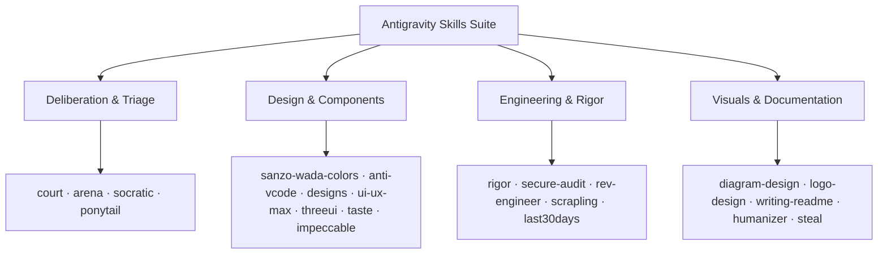

# Antigravity Skills Suite

[](./test_all.py)
[](#included-skills-matrix)
[-success.svg)](#system-requirements--prerequisites)
[](./LICENSE)
[](#quickstart--installation-tracks)

> A verified collection of 21 modular AI coding skills for Google Antigravity IDE and Claude Code, built on the Python standard library with zero runtime dependencies.

[ᴀɴᴛɪɢʀᴀᴠɪᴛʏ](#track-1-google-antigravity-ide-recommended) • [ɪɴᴛᴇʀᴀᴄᴛɪᴠᴇ](#track-2-guided-interactive-wizard) • [ʙᴜɴᴅʟᴇs](#track-3-curated-domain-bundles) • [ᴄʟᴀᴜᴅᴇ](#track-4-claude-code-setup) • [ᴘʀᴏᴊᴇᴄᴛ](#track-5-project-local-repository) • [ꜰᴀǫ](#-troubleshooting--faq)

---

## Table of Contents

- [Overview](#overview)
- [System Requirements & Prerequisites](#system-requirements--prerequisites)
- [Quickstart & Installation Tracks](#quickstart--installation-tracks)
  - [Track 1: Google Antigravity IDE (Recommended)](#track-1-google-antigravity-ide-recommended)
  - [Track 2: Guided Interactive Wizard](#track-2-guided-interactive-wizard)
  - [Track 3: Curated Domain Bundles](#track-3-curated-domain-bundles)
  - [Track 4: Claude Code Setup](#track-4-claude-code-setup)
  - [Track 5: Project-Local Repository](#track-5-project-local-repository)
  - [Track 6: Output Target Directory Map](#track-6-output-target-directory-map)
  - [Troubleshooting & FAQ](#troubleshooting--faq)
- [Included Skills Matrix](#included-skills-matrix)
- [System Architecture & Standards](#system-architecture--standards)
  - [Directory Layout Contract](#directory-layout-contract)
  - [Progressive Disclosure](#progressive-disclosure)
  - [Execution Triage & Circuit Breaker](#execution-triage--circuit-breaker)
- [Unified Parallel Verification](#unified-parallel-verification)
- [Trigger & Command Cheat Sheet](#trigger--command-cheat-sheet)
- [Packaging & Distribution](#packaging--distribution)
- [Contributing](#contributing)
- [License](#license)

---

## Overview

AI coding agents often struggle with four common patterns:
1. **Sycophancy**: agreeing with flawed technical proposals instead of stress-testing them.
2. **Visual Slop**: defaulting to generic purple gradients, floating cards, and uncalibrated animations.
3. **Over-Engineering**: introducing unnecessary dependencies and multi-file refactors for single-line bug fixes.
4. **Ungrounded Completion**: claiming a task is complete without running tests or verifying evidence.

The **Antigravity Skills Suite** provides 21 focused skills to solve these issues. Each skill functions as a self-contained module with structured system prompts, reference manuals, zero-dependency executable scripts, and automated unit tests.

The suite works natively with:
- **Google Antigravity IDE** (`~/.gemini/config/skills` or project-scoped `.agents/skills`)
- **Claude Code CLI** (`~/.claude/skills` or project-scoped `.claude/skills`)
- **Agent workspaces** supporting standard markdown skill conventions

---

## System Requirements & Prerequisites

Start by verifying your local environment before running the installer.

| Package | Minimum Version | Necessity | Purpose |
| :--- | :--- | :--- | :--- |
| **Python** | Python 3.10+ | Required | Runs all core engines, CLIs, and test suites. Pure standard library (zero pip packages required). |
| **Git** | Any modern version | Required | For cloning and tracking updates. |
| **Bash / Shell** | Bash 4+ or zsh | Required on Unix | For running `./install.sh`. |
| **Node.js** | Node 18+ | Optional | Only needed if executing live AST validators in `secure-audit` or `rev-engineer` MCP. |

> [!NOTE]
> There are no pip wheels or npm packages to install. All engines, BM25 indexers, and test runners use the native Python standard library.

---

## Quickstart & Installation Tracks

Choose the setup track that fits your environment.

### Track 1: Google Antigravity IDE (Recommended)
Installs all 21 skills globally into your Antigravity configuration directory (`~/.gemini/config/skills`). Once installed, every project workspace opened in Antigravity automatically discovers and uses them.

```bash
# 1. Clone the repository
git clone https://github.com/hamzzaqureshi/antigravity-skills.git
cd antigravity-skills

# 2. Run the 10-second automated installer
chmod +x install.sh && ./install.sh --all

# Or cross-platform on Windows (PowerShell or Command Prompt)
python3 install.py --all
```

**Verification:** Run the unified test runner immediately to confirm all 21 sandboxes are operational:
```bash
python3 -B test_all.py
```
Expected output: `Total Suite Runtime: ~1.6s | Result: ALL PASS (100%)`.

---

### Track 2: Guided Interactive Wizard
If you want to choose your destination directory or select individual skills through a visual menu, run the installer without flags:

```bash
./install.sh
# or on Windows: python3 install.py
```

The terminal wizard will guide you through two quick questions:
```text
========================================================================
       Google Antigravity Skills Suite: Guided Installer
========================================================================

Step 1: Choose destination:
  1) Antigravity Global        (~/.gemini/config/skills) [Recommended]
  2) Current Project Workspace (./.agents/skills)        [Project-scoped]
  3) Claude Code Global        (~/.claude/skills)        [Claude CLI]
  4) Claude Code Project       (./.claude/skills)
  5) Custom Directory

Select destination [1-5] (default: 1): 1

Step 2: Choose skills to install:
  1) Install All 21 Skills [Recommended - Complete Toolkit]
  2) Frontend & Design Bundle (9 skills: anti-vcode, designs, ui-ux-max...)
  3) Engineering & Security Bundle (8 skills: rigor, secure-audit, socratic...)
  4) Writing & Research Bundle (4 skills: writing-readme, humanizer, steal...)
  5) Custom Pick (select by numbers e.g. 1, 8, 20)

Select skills [1-5] (default: 1): 1
```

---

### Track 3: Curated Domain Bundles
If you only need tools for a specific domain, use the `--bundle` flag to install a targeted group:

```bash
# Frontend & Design (9 skills)
./install.sh --bundle design

# Engineering & Security (8 skills)
./install.sh --bundle engineering

# Writing & Research (4 skills)
./install.sh --bundle prose
```

| Bundle | Count | Included Skills | Target Use Case |
| :--- | :---: | :--- | :--- |
| **`design`** | 9 | `anti-vcode`, `designs`, `ui-ux-max`, `threeui`, `taste`, `sanzo-wada-colors`, `diagram-design`, `logo-design`, `impeccable` | Web applications, design systems, UI components, typography, color harmony. |
| **`engineering`** | 8 | `rigor`, `secure-audit`, `socratic`, `court`, `rev-engineer`, `scrapling`, `ponytail`, `arena` | Architecture reviews, vulnerability audits, scraping, reverse engineering, minimal diffs. |
| **`prose`** | 4 | `writing-readme`, `humanizer`, `steal`, `last30days` | Technical documentation, editorial humanizing, creative synthesis, temporal research. |

You can also cherry-pick exact skills by comma-separated names:
```bash
./install.sh --skills court,taste,rigor -g
```

---

### Track 4: Claude Code Setup
For developers using the Claude Code CLI, install the skills into the Claude configuration directory:

```bash
# Global installation for Claude Code (~/.claude/skills)
./install.sh --all --claude

# Or project-specific installation for Claude Code (./.claude/skills)
./install.sh --all --claude-project
```

Once installed, invoke skills directly in your Claude Code sessions (e.g. `/court`, `/rigor`, `/taste`).

---

### Track 5: Project-Local Repository
If you work with a team and want skills committed directly into a git repository without requiring global machine setup:

```bash
# Install all skills into current project's .agents/skills directory
./install.sh --all --project

# Or install a specific bundle into another project repository
./install.sh --bundle engineering --project /path/to/my-repo
```

Commit the generated `.agents/skills` directory into your repository:
```bash
git add .agents/skills
git commit -m "chore: add engineering skills suite for agent workflows"
```
Antigravity automatically discovers and loads skills located in `./.agents/skills` for all collaborators working on that repository.

---

### Track 6: Output Target Directory Map

| Destination Flag | Target Directory | Active Runtime | Discovery Mechanism |
| :--- | :--- | :--- | :--- |
| `-g`, `--global` | `~/.gemini/config/skills/` | Google Antigravity IDE | Automatic global discovery across all projects |
| `-p`, `--project` | `./.agents/skills/` | Google Antigravity IDE | Project-scoped discovery (committed to git) |
| `-c`, `--claude` | `~/.claude/skills/` | Claude Code CLI | Global discovery for Claude sessions |
| `--claude-project` | `./.claude/skills/` | Claude Code CLI | Project-scoped discovery for Claude |
| `--custom DIR` | Custom user path | Custom Agent Runtimes | Explicit path reference |

---

### Troubleshooting & FAQ

#### Does Antigravity require a restart after installing new skills?
No. Google Antigravity detects newly added skills in `~/.gemini/config/skills` or `.agents/skills` immediately. If a session is currently running, opening a new chat tab refreshes the active skill index.

#### Do I need to run `pip install` or configure a virtual environment?
No. Every tool in this suite is engineered to run exclusively on the Python standard library. No external pip packages, virtualenvs, or package lockfiles are needed.

#### How do I run this on Windows?
Run `python3 install.py` (or `python install.py`) directly in PowerShell or Command Prompt. The Python installer is completely cross-platform and supports all the same flags (`--all`, `--bundle`, `--skills`, `--project`).

#### How do I update skills when the repository changes?
Pull the latest changes from git and run the installer again:
```bash
git pull origin main
./install.sh --all
```
The installer uses clean rsync synchronization, replacing old versions while leaving zero cache artifacts.

#### How do I remove a skill?
Delete the corresponding folder from your target directory:
```bash
# Remove a single skill globally
rm -rf ~/.gemini/config/skills/arena

# Or wipe all global skills
rm -rf ~/.gemini/config/skills
```

---

## Included Skills Matrix

| Skill | Category | Core Purpose | Key Commands & Tools |
| :--- | :--- | :--- | :--- |
| **[`court`](./court)** | Deliberation | Adversarial multi-perspective idea and architecture trials to combat sycophancy. | `/court`, 12 Persona Lenses, `VERDICT.md`, `court.py` |
| **[`secure-audit`](./secure-audit)** | Security | Source-first, coverage-led vulnerability hunting with verified machine-readable findings. | 60+ Attack Classes, Reconnaissance, Node AST Validators |
| **[`anti-vcode`](./anti-vcode)** | Frontend Taste | Enforce human-authored design, Fibonacci proportions, Swiss discipline, and ban AI-slop signs. | `audit.py` Scanner, 40-Point Checklist, Restrained Motion |
| **[`impeccable`](./impeccable)** | Design Systems | Design lifecycle director with 24 commands, durable `PRODUCT.md` context, and offline detector. | `/impeccable init`, `polish`, `overdrive`, Rust Detector |
| **[`steal`](./steal)** | Ideation | Austin Kleon creative operating system: lineage mapping, multi-source synthesis, and originality audit. | `/steal`, `/artist`, Idea Bank (`ideas.json`), `artist.py` |
| **[`taste`](./taste)** | Frontend Taste | Leonxlnx v2 framework: brief inference, creative dials, GSAP choreography, and 12-point preflight. | `/taste`, 3 Dials (`VARIANCE`, `MOTION`, `DENSITY`), `taste.py` |
| **[`designs`](./designs)** | Design Tokens | Curated registry of 67 complete design systems (TypeUI): tokens, typography scales, and palettes. | `/designs`, 67 Themes (Glass, Brutalism, Bento), `design_system.py` |
| **[`ui-ux-max`](./ui-ux-max)** | Design Intelligence | BM25 design reasoning: 79 styles, 192 palettes, 74 font pairings, 22 stacks, 119 UX guidelines. | `/ui-ux-max`, `--design-system`, `--persist`, `search.py` |
| **[`threeui`](./threeui)** | 3D & WebGL | 104 production Three.js components, raymarched shaders, 3D buttons, and kinetic typography. | `threeui.py`, 9 Categories, TSX + GLSL, R3F & Next.js |
| **[`rev-engineer`](./rev-engineer)** | Reverse Engineering | Decompilation, Electron/JS unpacking, APK analysis, and binary reconstruction with REA. | `rea_helper.py`, REA MCP (`npx rea-agents@latest`), 9 Routes |
| **[`logo-design`](./logo-design)** | Brand Identity | Disciplined vector logo designer with 1,400+ SVG reference library, audit suite, and mockup generator. | `svg_audit.py`, `concept_sheet.py`, `search_library.py` |
| **[`writing-readme`](./writing-readme)** | Documentation | Technical documentation framework: 4-stage reader journey, 5 archetypes, and 50-point quality rubric. | `readme_audit.py`, `generate_readme.py`, 6 Templates |
| **[`arena`](./arena)** | Deliberation | 100 sub-agents single-elimination tournament to eliminate bad answers and find the single survivor. | `/arena`, 2,160 Strategy Cards, 5 Phases, `bracket.py` |
| **[`ponytail`](./ponytail)** | Minimalism | Lazy senior developer mode: smallest complete diff, YAGNI, standard library reuse, and debt tracking. | `/ponytail` (lite/full/ultra), `/ponytail-review`, `debt.py` |
| **[`last30days`](./last30days)** | Intelligence | Real-time temporal research engine scored by engagement (Reddit, X, YouTube, HN, Polymarket). | `/last30days`, 24 Sources, YouTube transcripts, `pulse.py` |
| **[`scrapling`](./scrapling)** | Web Scraping | High-performance scraping framework: Cloudflare Turnstile bypass, concurrent spiders, and clean RAG text. | FetcherSession, StealthySession, `scrapling_helper.py` |
| **[`humanizer`](./humanizer)** | Prose Polish | Wikipedia-backed 26-pattern anti-AI-writing polish: removes tells, forced triads, and staged openers. | `/humanizer`, 26 Patterns, Voice Matching, `humanize_audit.py` |
| **[`diagram-design`](./diagram-design)** | Schematics | Editorial diagram design: 45 diagram types, zero box shadows, no Mermaid slop, .drawio/.mmd converter. | 45 Types, 9 Patterns, Pure HTML+SVG, `antigravity_helper.py` |
| **[`socratic`](./socratic)** | Deliberation | Senior engineering self-interrogation: 15 domains, 10 decision packs, and production readiness gates. | Silent Mode, 10 Decision Packs, 3 Gates, `socratic_engine.py` |
| **[`rigor`](./rigor)** | Rigor & Discipline | Grounding against live docs, disk-backed task ledgers, cross-model reviews, and strict completion gates. | `/rigor`, 4 Verification Gates, Evidence Table, `rigor_engine.py` |
| **[`sanzo-wada-colors`](./sanzo-wada-colors)** | Color Harmony | 348 curated palettes (120 duos, 120 trios, 108 quads) from 159 pigments with WCAG contrast and CSS tokens. | `/wada`, `/colors`, `/palette`, 348 Palettes, `color_engine.py` |

---

## System Architecture & Standards



### Directory Layout Contract
Every skill in this repository strictly adheres to the standard layout:

```text
<skill-name>/
├── SKILL.md             # [Required] Dense agent entrypoint with YAML frontmatter
├── README.md            # [Required] Quickstart, triggers, and usage reference
├── LICENSE              # [Required] Open-source license (MIT / Apache-2.0)
├── .gitignore           # [Required] Clean version control exclusions
├── references/          # [Progressive Disclosure] In-depth manuals loaded on demand
├── scripts/             # [Execution] Zero-dependency engines, CLIs, and validators
├── resources/           # [Data] Schemas, personas, and templates
└── tests/               # [Verification] Fast automated unit test suites
```

### Progressive Disclosure
To prevent overflowing the agent context window, `SKILL.md` files contain only high-density instructions, operational triggers, and decision trees. Specialized references (such as specific CVE hunting rules or shader formulas) remain in `references/` and are read by the agent strictly when needed.

### Execution Triage & Circuit Breaker
Every implementation task follows a three-tier execution path:
- **`DIRECT`** (under 20 lines or known bug): Zero planning overhead. Make the edit, verify tests, finish immediately.
- **`LIGHT`** (localized change with 1 reversible fork): State the decision in one sentence, execute, verify.
- **`ROADMAP`** (multi-file refactor or schema migration): State invariants, stage into clean milestones, and verify tests at each milestone.
- **No-Progress Circuit Breaker**: If an edit produces the exact same test failure twice consecutively, the agent halts blind retries and re-evaluates the strategy.

---

## Unified Parallel Verification

The test runner validates all 21 skills in parallel using the Python standard library `unittest` framework:

```bash
python3 -B test_all.py
```

Expected output:
```text
========================================================================
          GOOGLE ANTIGRAVITY SKILLS SUITE - TEST RUNNER
========================================================================
Mode: High-Performance Parallel (21 suites across isolated sandboxes)

  [court               ] PASS in 0.125s (Adversarial Idea Deliberation Engine)
  [secure-audit        ] PASS in 0.903s (Coverage Ledger & Findings Validators (65 tests))
  [anti-vcode          ] PASS in 0.107s (40-Sign Anti-Slop Code Scanner)
  [impeccable          ] PASS in 0.204s (24-Command Design Framework & Detector Smoke Tests)
  [steal               ] PASS in 0.130s (Creative Lineage & Originality Audit Engine)
  [taste               ] PASS in 0.100s (Anti-Slop Frontend Dials & 12-Point Preflight Auditor)
  [designs             ] PASS in 0.193s (Curated 67 Design System Themes & Token Registry)
  [ui-ux-max           ] PASS in 0.578s (UI/UX Pro Max BM25 Design Intelligence Engine)
  [threeui             ] PASS in 0.309s (ThreeUI 3D & WebGL 104-Component Engine)
  [rev-engineer        ] PASS in 0.345s (REA Reverse Engineer Anything (MCP Binary & Runtime Engine))
  [logo-design         ] PASS in 0.823s (Logo Design & SVG Identity Engine (1,400+ Reference Library))
  [writing-readme      ] PASS in 0.308s (The Art of Writing Excellent GitHub READMEs (50-Point Auditor & Scaffolder))
  [arena               ] PASS in 0.788s (The Arena (100 Sub-Agents Single-Elimination Bracket Tournament))
  [ponytail            ] PASS in 0.103s (Ponytail (Lazy Senior Dev: Minimal Diff & Zero Over-Engineering Engine))
  [last30days          ] PASS in 1.531s (last30days & CrowdPulse Fast-Lane (Real-Time Temporal Intelligence Engine))
  [scrapling           ] PASS in 0.735s (Scrapling (Adaptive Web Scraping, Stealth Browsing & Anti-Bot Bypass))
  [humanizer           ] PASS in 0.242s (Humanizer (26-Pattern Anti-AI-Writing Prose Polish & Slop Eliminator))
  [diagram-design      ] PASS in 0.806s (Diagram Design (45-Type Editorial HTML+SVG Diagrams & Antigravity IDE Engine))
  [socratic            ] PASS in 0.284s (Socratic (Silent Self-Interrogation & 3am Readiness Gates))
  [rigor               ] PASS in 0.549s (Rigor (Empirical Engineering Discipline: Grounding, Task Ledger & Completion Gates))
  [sanzo-wada-colors   ] PASS in 0.300s (Sanzo Wada Colors (348 Palettes, 159 Pigments, WCAG Matrix & Token Engine))
========================================================================
                         SUMMARY REPORT
========================================================================
Skill                | Status     | Runtime   
------------------------------------------------------------------------
court                | PASSED     | 0.125s
secure-audit         | PASSED     | 0.903s
anti-vcode           | PASSED     | 0.107s
impeccable           | PASSED     | 0.204s
steal                | PASSED     | 0.130s
taste                | PASSED     | 0.100s
designs              | PASSED     | 0.193s
ui-ux-max            | PASSED     | 0.578s
threeui              | PASSED     | 0.309s
rev-engineer         | PASSED     | 0.345s
logo-design          | PASSED     | 0.823s
writing-readme       | PASSED     | 0.308s
arena                | PASSED     | 0.788s
ponytail             | PASSED     | 0.103s
last30days           | PASSED     | 1.531s
scrapling            | PASSED     | 0.735s
humanizer            | PASSED     | 0.242s
diagram-design       | PASSED     | 0.806s
socratic             | PASSED     | 0.284s
rigor                | PASSED     | 0.549s
sanzo-wada-colors    | PASSED     | 0.300s
========================================================================
Total Suite Runtime: 1.551s | Result: ALL PASS (100%)
========================================================================
```

---

## Trigger & Command Cheat Sheet

| Intent | Antigravity IDE / Terminal CLI Command |
| :--- | :--- |
| **Stress-test an idea** | `/court Quit my job to sell handmade candles full time.` |
| **Audit system architecture** | `Put this architecture on trial: migrating PostgreSQL to DynamoDB.` |
| **Run a security audit** | `Security audit this codebase and output findings to ~/audits/run-1.` |
| **Scan code for AI slop** | `python3 -B anti-vcode/scripts/audit.py ./src` |
| **Initialize product truth** | `/impeccable init` |
| **Polish UI before launch** | `/impeccable polish` |
| **Add high-end visual effect**| `/impeccable overdrive hero section` |
| **Synthesize novel features** | `/steal Design a zero-dependency CLI status monitor blending Quake HUDs and Unix pipes` |
| **Audit idea originality** | `/steal audit ./proposals/architecture.md` |
| **Anti-slop frontend brief** | `/taste Design a Linear-style minimalist developer landing page for telemetry.` |
| **Infer design dials** | `python3 -B taste/scripts/taste.py infer --brief "B2B SaaS landing page"` |
| **Apply design system theme** | `/designs apply glassmorphism` |
| **Export theme tokens to CSS**  | `python3 -B designs/scripts/design_system.py export-css neobrutalism --output tokens.css` |
| **Generate full design spec** | `python3 -B ui-ux-max/scripts/search.py "fintech banking mobile" --design-system -p "NovaBank"` |
| **Query UX guidelines & A11y** | `python3 -B ui-ux-max/scripts/search.py "error summary validation" --domain ux` |
| **Search 3D Three.js library**| `python3 -B threeui/scripts/threeui.py search "liquid"` |
| **Export 3D component to app**   | `python3 -B threeui/scripts/threeui.py export liquid-metal-button -o ./src/components` |
| **Route binary to REA tool**     | `python3 -B rev-engineer/scripts/rea_helper.py route /path/to/app.asar` |
| **Design a brand mark or logo**  | `Design a logo for Harbor, a savings app for first-time savers. Calm and safe, no piggy banks.` |
| **Audit SVG logo craft & score** | `python3 -B logo-design/scripts/svg_audit.py ./my_logo.svg` |
| **Audit README with 50-pt rubric**| `python3 -B writing-readme/scripts/readme_audit.py ./README.md` |
| **Scaffold tailored README**     | `python3 -B writing-readme/scripts/generate_readme.py --archetype ai-ml --name "MyModel"` |
| **Run 100-agent tournament**     | `/arena Benchmark 100 solutions for an in-memory TTL LRU cache in Rust.` |
| **Minimal diff developer mode**  | `/ponytail Fix this bug using the smallest possible diff and standard library only.` |
| **Track shortcut debt**          | `python3 -B ponytail/scripts/debt.py` |
| **Research real-time consensus** | `/last30days Claude Code vs Codex vs OpenClaw` |
| **Instant community pulse**      | `python3 -B last30days/scripts/pulse.py "react 19"` |
| **Bypass Cloudflare & scrape**   | `scrapling extract fetch "https://nopecha.com/demo/cloudflare" captchas.html --solve-cloudflare` |
| **Humanize AI prose**            | `/humanizer Clean the AI writing tells and corporate buzzwords from this draft.` |
| **Audit prose for 26 AI tells**  | `python3 -B humanizer/scripts/humanize_audit.py README.md` |
| **Scaffold editorial diagram**   | `python3 -B diagram-design/scripts/antigravity_helper.py scaffold architecture diagram.html --theme=antigravity-dark` |
| **Validate diagram compliance**  | `python3 -B diagram-design/scripts/antigravity_helper.py validate diagram.html` |
| **Self-interrogate before build**| `Design a distributed queue with Postgres and Redis. Self-interrogate silently before building.` |
| **Check 3am production gate**    | `python3 -B socratic/scripts/socratic_engine.py gate production` |
| **Enforce empirical discipline** | `/rigor Build a JWT rotation service. Refuse completion claims without fresh test output.` |
| **Verify completion gate**      | `python3 -B rigor/scripts/rigor_engine.py verify-gate "All tests pass. 14 passed in 0.2s, exit 0" --strict` |
| **Inspect Sanzo Wada palette**   | `python3 -B sanzo-wada-colors/scripts/color_engine.py combo 198` |
| **Export palette to CSS tokens** | `python3 -B sanzo-wada-colors/scripts/color_engine.py export 198 --format css` |
| **Audit WCAG contrast ratios**   | `python3 -B sanzo-wada-colors/scripts/color_engine.py contrast 198` |

---

## Packaging & Distribution

To create standalone release archives for distribution:

```bash
python3 -B package.py
```

Generated artifacts in `dist/`:
- `antigravity-skills.zip` (~20.8 MB): Universal clean archive ready to unzip and install.
- `antigravity-skills.tar.gz` (~19.3 MB): Standard POSIX tarball.
- `antigravity-skills-pack/`: Pre-staged directory ready to place into `~/.gemini/config/plugins/`.
- `checksums.sha256`: Cryptographic SHA-256 verification hashes.

For detailed release steps, see [SHARING.md](./SHARING.md).

---

## Contributing

Contributions, bug reports, and new skills are welcome. Please ensure that:
1. All new skills follow the directory convention (`SKILL.md`, `references/`, `scripts/`, `tests/`).
2. Scripts use the Python standard library or native Node.js without external package dependencies.
3. `python3 -B test_all.py` passes with a 100% success rate.
4. Python files run with the `-B` flag to prevent bytecode cache generation.

See [CONTRIBUTING.md](./CONTRIBUTING.md) for complete contribution guidelines.

---

## License

The Antigravity Skills Suite is open-source software licensed under the [MIT License](./LICENSE). Individual third-party adapted tools retain their respective upstream licenses.
