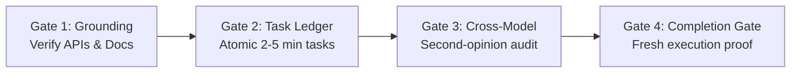

# Rigor: Engineering Discipline for AI Coding Agents

[](tests/)
[](SKILL.md)
[](scripts/rigor_engine.py)
[](../LICENSE)

> **"Model memory is a hypothesis. A fact needs evidence. If you did not run it just now, you do not know it."**

**Rigor** is an engineering discipline skill for coding agents. It enforces empirical verification across four critical gates: grounding against primary sources, atomic task management with surviving disk ledgers, cross-model review to eliminate vendor blindspots, and a strict completion gate that disallows declaring "done" without terminal output in the exact same response.

---

## The 4 Verification Gates



### 1. Grounding Protocol
- **The Rule**: Treat what an LLM remembers about APIs, flags, limits, or pricing as an unverified hypothesis.
- **The Ladder**:
  1. Primary source 1: Installed executable (`tool --help`, `tool --version`).
  2. Primary source 2: Local project types, lockfiles, and code (`package.json`, `.d.ts`).
  3. Primary source 3: Official maintainer documentation & GitHub release notes.
- **Probe**: `rigor ground <package_or_binary>`

### 2. Atomic Task Ledger
- **The Rule**: No complex implementation proceeds without atomic tasks and disk-backed state.
- Tasks are scoped to 2–5 minutes with exact files, interfaces, and tests.
- State is preserved on disk under `<repo>/.rigor/runs/<slug>/progress.md` so progress survives context window loss and subagent boundaries.

### 3. Cross-Model Review
- **The Rule**: Before landing critical code, get an outside read from another model family (e.g., Gemini auditing Claude, or Codex auditing Gemini).
- Different model families possess different blind spots; dispatch a read-only brief with 3–5 falsifiable, checkable questions.

### 4. Completion Gate
- **The Rule**: *NO CLAIM OF DONE, FIXED, OR PASSING WITHOUT FRESH VERIFICATION OUTPUT IN THIS MESSAGE.*
- Prohibits vague assurances like "I've resolved the issue."
- Mandates an Evidence Table and fresh terminal exit codes/test counts before marking work complete.

---

## CLI Usage

The skill includes a zero-dependency Python utility (`bin/rigor` or `scripts/rigor_engine.py`):

```bash
# 1. Initialize a plan workspace
rigor workspace docs/plans/2026-auth.md

# 2. Extract brief for Task 1
rigor brief docs/plans/2026-auth.md 1

# 3. Append to persistent progress ledger
rigor ledger <workspace> "Task 1: complete (tests green, SHA: a1b2c3d)"

# 4. Check workspace status and next task
rigor status <workspace>

# 5. Generate review package for secondary model
rigor review-package main HEAD

# 6. Verify completion gate evidence in response
rigor verify-gate "<response_text>" --strict

# 7. Ground a package or command against local environment
rigor ground pytest
```

---

## Directory Layout

```
rigor/
├── bin/
│   └── rigor                         # Executable CLI wrapper
├── scripts/
│   └── rigor_engine.py               # Pure Python 3 engine (zero external dependencies)
├── references/
│   ├── completion-gate-table.md      # Evidence Table specification & rules
│   ├── grounding-ladder.md           # 5-rung verification ladder
│   ├── cross-model-brief.md          # Secondary review brief template
│   └── task-ledger-spec.md           # Workspace structure & ledger specification
├── tests/
│   └── test_rigor.py                 # Automated unit tests (12 tests)
├── README.md
└── SKILL.md
```

---

## Automated Verification

Run unit tests via standard Python unittest:
```bash
python3 -B -m unittest discover -s tests
```

