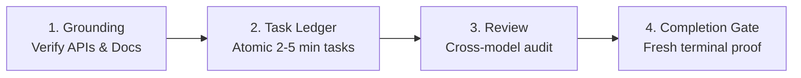

# Rigor: Engineering Discipline for AI Agents

> **"Model memory is a hypothesis. A fact needs evidence. If you did not run it just now, you do not know it."**

Rigor synthesizes high-reliability engineering discipline into 4 non-negotiable verification gates:
1. **Grounding Protocol**: Verify external libraries, APIs, and CLI flags against primary sources before coding.
2. **Task Ledger**: Break work into atomic, verifiable tasks with persistent disk-backed state surviving context loss.
3. **Cross-Model Review**: Dispatch critical diffs to an independent model family or subagent to eliminate blindspots.
4. **Completion Gate**: Disallow any claim of "done", "fixed", or "passing" without fresh execution output in that exact message.

---

## The 4 Gates of Rigor



---

### Gate 1: Grounding Protocol

**The Rule:** *No fact that can change enters code or an answer unverified.*

- **Hypothesis vs Fact**: Treat what you remember about an API, CLI flag, version, or platform constraint as a hypothesis.
- **Climb the Ladder**:
  1. Primary source 1: Installed tool (`tool --version`, `tool --help`, one-line probe).
  2. Primary source 2: Local project types, lockfile, source code (`package.json`, `Cargo.lock`, `poetry.lock`).
  3. Primary source 3: Official docs, GitHub repository releases, changelogs.
- **Helper Command**:
  ```bash
  python3 -B /path/to/rigor/scripts/rigor_engine.py ground <tool_or_package>
  ```

---

### Gate 2: Task Ledger & Atomic Briefs

**The Rule:** *No complex implementation proceeds without atomic tasks and disk-backed state.*

- Keep tasks between **2 to 5 minutes** of work: exact file paths, interfaces consumed/produced, and tests written first.
- Maintain disk-backed progress under `<repo>/.rigor/runs/<slug>/` so progress survives context window compaction and subagent isolation.
- **Helper Commands**:
  ```bash
  # Initialize plan workspace
  ws=$(python3 -B /path/to/rigor/scripts/rigor_engine.py workspace docs/plans/feature.md)

  # Extract brief for Task 1
  brief=$(python3 -B /path/to/rigor/scripts/rigor_engine.py brief docs/plans/feature.md 1 "$ws")

  # Log progress and check status
  python3 -B /path/to/rigor/scripts/rigor_engine.py ledger "$ws" "Task 1: complete (tests green)"
  python3 -B /path/to/rigor/scripts/rigor_engine.py status "$ws"
  ```

---

### Gate 3: Cross-Model Review

**The Rule:** *Before landing critical code, get an outside read from another model family or independent subagent.*

- Models of the same family share identical blindspots and common failure modes.
- Dispatch a read-only review with 3–5 checkable, falsifiable questions (see [cross-model-brief.md](file:///home/hamza/Documents/skills/rigor/references/cross-model-brief.md)).
- **Helper Command**:
  ```bash
  python3 -B /path/to/rigor/scripts/rigor_engine.py review-package main HEAD "$ws"
  ```

---

### Gate 4: Completion Gate

**The Rule:** *NO CLAIM OF DONE, FIXED, OR PASSING WITHOUT FRESH VERIFICATION OUTPUT IN THIS MESSAGE.*

Before uttering any variant of:
- *"I have fixed the bug"*,
- *"All tests are passing"*,
- *"The feature is complete"*,
- *"Everything is working as expected"*,

You **must** run the command in the terminal and display the raw exit code and output in the response alongside an Evidence Table:

| Claim | Command or Check | Result (Observed in This Message) | Status |
|---|---|---|---|
| Tests pass | `pytest tests/` | `24 passed, 0 failed in 0.35s, exit 0` | Verified |
| Types clean | `mypy src/` | `Success: no issues found in 12 source files` | Verified |
| Bug reproduced & resolved | `python test_repro.py` | `Fails before; exits 0 with fix applied` | Verified |

- **Validator Command**:
  ```bash
  python3 -B /path/to/rigor/scripts/rigor_engine.py verify-gate "<response_text_or_file>"
  ```

---

## When to Use

- **Required**:
  - Before declaring any task or milestone finished.
  - When committing, merging, or releasing production code.
  - Before writing code against third-party APIs or unfamiliar CLI tools.
  - When a user asks for `/rigor`, "prove it", "check your work", or "be thorough".
- **Skip**:
  - Fast exploratory brainstorming and throwaway scratchpad spikes.
  - Simple 1-line conversational queries that do not modify files or make verifiable claims.

---

## References

- [Completion Gate & Evidence Table](file:///home/hamza/Documents/skills/rigor/references/completion-gate-table.md)
- [The 5-Rung Grounding Ladder](file:///home/hamza/Documents/skills/rigor/references/grounding-ladder.md)
- [Cross-Model Review Brief Template](file:///home/hamza/Documents/skills/rigor/references/cross-model-brief.md)
- [Task Ledger Specification](file:///home/hamza/Documents/skills/rigor/references/task-ledger-spec.md)

