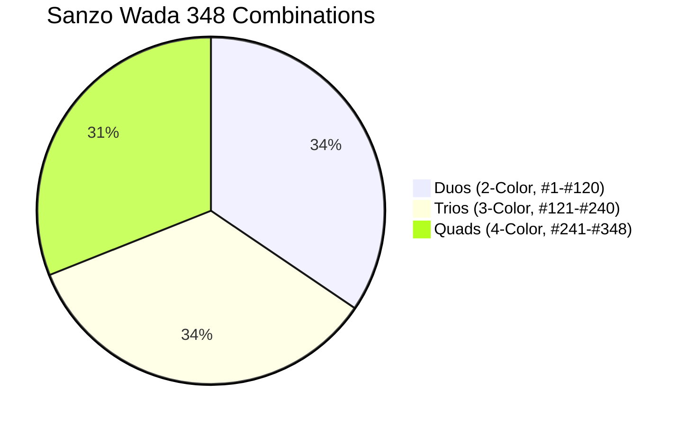

# Sanzo Wada Colors: A Dictionary of Color Combinations (1930s)

[](tests/)
[](SKILL.md)
[](references/wada-color-index.md)
[](scripts/color_engine.py)
[](../LICENSE)

> **"True color harmony is not generated by algorithms; it is discovered through disciplined cultural perception."**

**Sanzo Wada Colors** brings the complete 1930s Japanese avant-garde color harmony catalog from Sanzo Wada's (1883–1967) *A Dictionary of Color Combinations* (*Haishoku Soukan*) directly into Google Antigravity. It features **348 historically curated color combinations** and **159 unique historical pigments** with precise Hex, RGB, CMYK, and CIE $L^*a^*b^*$ coordinates, accompanied by a zero-dependency Python CLI engine for instant visual swatch inspection, WCAG accessibility auditing, and CSS/Tailwind design token generation.

---

## The 348 Palettes Architecture



1. **Duos (`#1` to `#120`)**: High-contrast 2-color pairs for typography, monograms, logos, and light/dark polarity.
2. **Trios (`#121` to `#240`)**: 3-color structural balance (Surface 60%, Structure 30%, Accent 10%) for web apps and SaaS product shells.
3. **Quads (`#241` to `#348`)**: 4-color categorical systems for charts, badges, and complex dashboard components.

---

## CLI Usage

The skill includes a zero-dependency CLI engine (`bin/wada` or `scripts/color_engine.py`):

```bash
# 1. Inspect combination #198 with ANSI TrueColor swatches & WCAG contrast matrix
wada combo 198

# 2. Search colors by name or hex
wada search "indigo"
wada search "sienna"

# 3. List palettes filtered by size (duos: 2, trios: 3, quads: 4)
wada list --size 3 --limit 10

# 4. Pick a random harmonious palette
wada random --size 3

# 5. Export to CSS variables or Tailwind tokens
wada export 198 --format css
wada export 198 --format tailwind
wada export 198 --format svg > palette.svg

# 6. Audit accessibility & WCAG 2.1 contrast ratios
wada contrast 198
```

---

## Directory Layout

```
sanzo-wada-colors/
├── bin/
│   └── wada                          # Executable CLI wrapper
├── data/
│   └── colors.json                   # 159 colors and 348 combinations dataset (60 KB)
├── scripts/
│   └── color_engine.py               # Pure Python standard-library engine
├── references/
│   ├── wada-color-index.md           # Alphabetical catalog of all 159 traditional colors
│   └── palette-types-guide.md        # UI/UX selection guide (Duos, Trios, Quads)
├── tests/
│   └── test_sanzo_wada.py            # Automated unit tests (11 tests)
├── README.md
└── SKILL.md
```

---

## Automated Verification

Run unit tests via standard Python unittest:
```bash
python3 -B -m unittest discover -s tests
```

