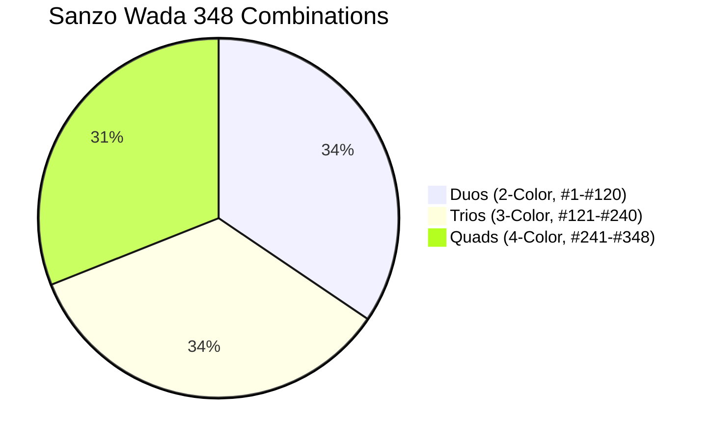

# Sanzo Wada Color Dictionary (348 Palettes)

> **"True color harmony is not generated by algorithms; it is discovered through disciplined cultural perception."**

This skill provides direct access to the digital dataset of **Sanzo Wada's (1883–1967) *A Dictionary of Color Combinations*** (*Haishoku Soukan*, published in Japan in the 1930s). It contains **348 historically curated color combinations** and **159 unique pigments** with precise Hex, RGB, CMYK, and CIE $L^*a^*b^*$ coordinates.

Use this skill whenever you need timeless, editorial-grade color palettes that avoid generic "AI color slop" (such as random neon purple/blue gradients).

---

## Palette Breakdown



- **Duos (#1 to #120)**: High-impact 2-color pairings. Perfect for minimalist typography, logos, brand marks, and dark/light polarity.
- **Trios (#121 to #240)**: 3-color structural balance (Dominant surface 60%, Secondary structure 30%, Accent highlight 10%). Ideal for SaaS product shells and landing pages.
- **Quads (#241 to #348)**: 4-color categorical systems. Ideal for data visualization ramps, multi-state status badges, and illustrations.

---

## When to Use

- **Web & Landing Pages**: Designing landing pages or dashboards that need a sophisticated, editorial aesthetic instead of generic tech cliches.
- **Brand Identity & Logos**: Selecting high-contrast, memorable brand colors for logos (used with [`logo-design`](file:///home/hamza/Documents/skills/logo-design)).
- **Data Visualization**: Categorical color palettes for charts, heatmaps, and diagrams (used with [`diagram-design`](file:///home/hamza/Documents/skills/diagram-design)).
- **Design Tokens**: Exporting production-ready CSS variables or Tailwind color scales.

---

## CLI & Engine Commands

The skill includes a zero-dependency CLI engine (`bin/wada` or `scripts/color_engine.py`):

```bash
# 1. Inspect a combination by ID (1 to 348) with TrueColor ANSI swatches and WCAG matrix
python3 -B /path/to/sanzo-wada-colors/scripts/color_engine.py combo 198

# 2. Search colors by name or hex (e.g. indigo, vermilion, sage, sienna)
python3 -B /path/to/sanzo-wada-colors/scripts/color_engine.py search "indigo"

# 3. List palettes filtered by size (duos: 2, trios: 3, quads: 4)
python3 -B /path/to/sanzo-wada-colors/scripts/color_engine.py list --size 3 --limit 10

# 4. Pick a serendipitous harmonious palette
python3 -B /path/to/sanzo-wada-colors/scripts/color_engine.py random --size 3

# 5. Export palette directly to CSS variables or Tailwind tokens
python3 -B /path/to/sanzo-wada-colors/scripts/color_engine.py export 198 --format css
python3 -B /path/to/sanzo-wada-colors/scripts/color_engine.py export 198 --format tailwind
python3 -B /path/to/sanzo-wada-colors/scripts/color_engine.py export 198 --format svg > palette.svg

# 6. Audit accessibility & WCAG 2.1 contrast ratios between all pairs
python3 -B /path/to/sanzo-wada-colors/scripts/color_engine.py contrast 198
```

---

## Protocol for Selecting Palettes

1. **Identify the Visual Role**:
   - Editorial / Minimalist / Monogram $\rightarrow$ Choose a **Duo** (`#1` to `#120`).
   - Web App / Product Shell / Dashboard $\rightarrow$ Choose a **Trio** (`#121` to `#240`).
   - Multi-tier data charts / Complex UI $\rightarrow$ Choose a **Quad** (`#241` to `#348`).
2. **Find a Anchor Color**:
   - Query by mood or material: `wada search "carmine"` or `wada search "olive"`.
   - Select one of the combination IDs where that anchor appears.
3. **Verify Contrast**:
   - Run `wada contrast <ID>`.
   - Ensure text-on-background pairs achieve at least **4.5:1** (WCAG AA).
   - Use lower-contrast combinations for non-text borders, cards, or subtle surface tints.
4. **Export to Code**:
   - Run `wada export <ID> --format css` to populate `:root` variables.

---

## References

- [Complete 159 Color Index](file:///home/hamza/Documents/skills/sanzo-wada-colors/references/wada-color-index.md)
- [Palette Types & UI Application Guide](file:///home/hamza/Documents/skills/sanzo-wada-colors/references/palette-types-guide.md)

