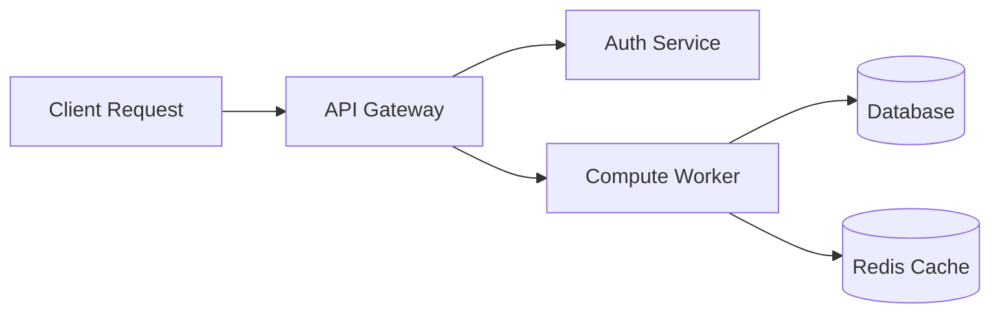

# Architecture & Visual Communication

> "A diagram communicates relationships and boundaries faster than five paragraphs of prose. But a bad diagram merely visualizes confusion."

---

## Visual Communication Hierarchy

1. **Working Code First:** An executable 3-line snippet often beats an abstract diagram.
2. **ASCII Flowcharts:** Universal, renders instantly in plaintext, terminals, and offline previewers.
3. **Mermaid Diagrams:** Natively rendered by GitHub, easy to version control in Git diffs.
4. **Screenshots & GIFs:** Essential for UI/UX applications, dashboards, and CLI interactions.

---

## When to Use Mermaid vs ASCII

### Mermaid Diagrams (GitHub Native)
Use Mermaid when modeling state machines, sequence interactions, or clean entity relationships.

```markdown

```

#### Best Practices for Mermaid:
- Always quote labels containing special characters: `id["User (Primary)"]`.
- Keep node count under 15 for readability on mobile screens.
- Avoid raw HTML formatting inside node labels.

### ASCII Box Diagrams (Plaintext Native)
Use ASCII diagrams for file directory trees, memory/packet layouts, or simple pipelines. They never break across Markdown parsers:

```text
┌──────────────┐         ┌──────────────┐         ┌──────────────┐
│  Raw Input   │ ──────▶ │ Preprocessor │ ──────▶ │ Output Model │
└──────────────┘         └──────────────┘         └──────────────┘
```

---

## Badges: Signals vs Clutter

Badges communicate project metadata at a glance, but **badge fatigue** destroys credibility.

### Good Badges (Signal)
- **CI / Build Status:** Proves the main branch is passing automated tests.
- **Package Version:** Informs developers of the latest release.
- **License:** Clarifies legal usability before adoption.
- **Coverage:** Indicates active test culture.

### Bad Badges (Clutter / Vanity)
- Redundant social buttons ("Star on GitHub", "Follow on Twitter").
- Five different package manager badges when the project only supports one.
- Meaningless decorative badges that do not link to real endpoints.

---

## Screenshot Best Practices

When embedding UI screenshots or terminal demos:
1. **Annotate Critical Elements:** Don't expect the user to hunt for the relevant button across a 4K desktop screenshot. Crop closely to the window or feature.
2. **Use Modern Formats:** Prefer PNG for crisp UI screenshots; use WebP or optimized GIFs/SVG animations for motion.
3. **Always Include Alt Text:** ``.
4. **Dark & Light Mode Friendly:** Test that borders are visible on both GitHub light and dark mode themes.
